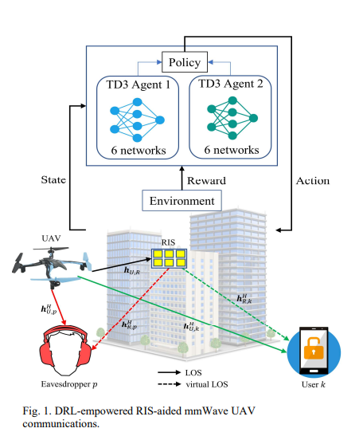
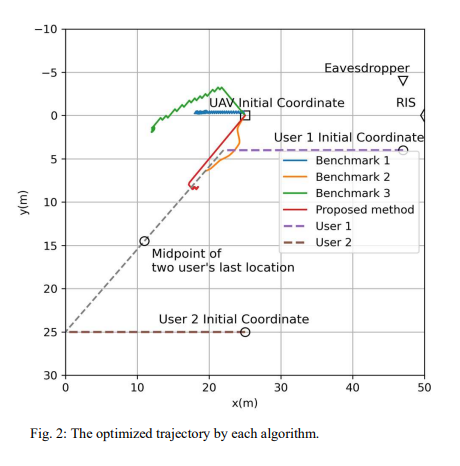
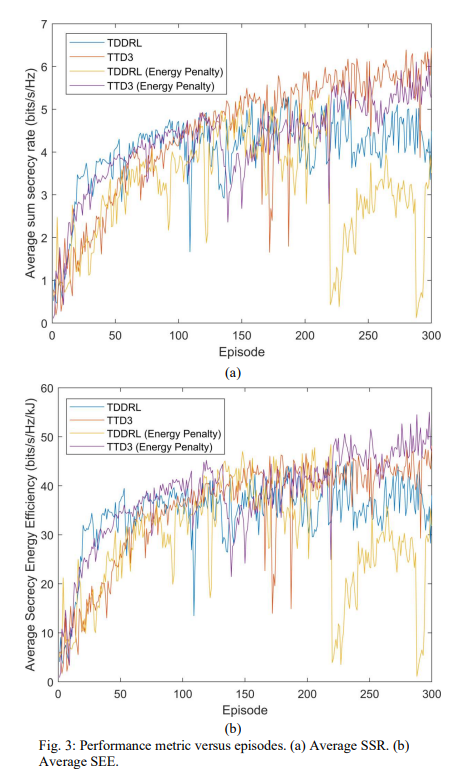

# [RL+UAV] Reconfigurable Intelligent Surface-Assisted Encryption and Efficiency UAV Communications Based on Deep Reinforcement Learning [Rewritten in Python]

I. Article title: Reconfigurable Intelligent Surfaces Assisted in Enhancing Security and Efficiency of UAV Communications Based on Deep Reinforcement Learning
II. Abstract This paper investigates the physical layer security (PLS) issue in reconfigurable intelligent surface (RIS)-assisted millimeter wave rotary UAV communication under multiple eavesdroppers and non-ideal channel state information (CSI). The research objective is to maximize the worst-case confidentiality efficiency (SEE) of the UAV by jointly optimizing the UAV flight trajectory, UAV active beamforming, and RIS passive beamforming.
By interacting with a dynamically changing drone environment, deep reinforcement learning (DRL) can achieve real-time decision-making for each slot. To decouple continuous optimization variables, the Double Delay Deep Deterministic Policy Gradient (TTD3) is introduced to maximize the expected cumulative reward, which is related to energy efficiency improvements. Simulation results show that the proposed method achieves higher energy conservation effects than the traditional DRL method based on the Double Deep Deterministic Policy Gradient (TDDRL).
III. Introduction 1
Drones (UAVs) as flying base stations or relay nodes are expected to become an integral part of the next-generation mobile networks, superseding 5G/6G. They can form a non-terrestrial network (NTN) with high-altitude platforms systems (HAPS) and satellites, offering large-scale connectivity and high capacity. However, their open wireless links make them vulnerable to security threats such as eavesdropping.
2  
3  
Energy efficiency is a key performance metric for drone networks. While research has proposed energy-minimization schemes for drone-assisted IoT systems, they have not considered eavesdroppers; similarly, there are studies that jointly optimize transmission power allocation and trajectory construction to maximize worst-case confidentiality energy efficiency (SEE), but require known ideal state information, which is challenging in practice due to the distribution of drone-assisted networks, which is influenced by drone mobility, user movement, and communication processing delays.
4  
In the absence of complete state information, deep reinforcement learning (DRL) that integrates deep neural networks (DNN) with reinforcement learning (RL) becomes an appropriate choice for solving real-time dynamic optimization problems. Inspired by related research, this paper considers the communication of a millimeter-wave rotary drone assisted by RIS in multi-eavesdroppers and non-ideal CSI, aiming to maximize worst-case SEE through joint optimization of the drone's flight trajectory, active and passive beamforming, and introduces dual TD3 (TTD3) to address the overestimation bias of DDPG, demonstrating its superior energy-saving effect compared to traditional TDDRL methods through simulation verification.
Conclusion 1:
This paper proposes a framework based on TTD3 to maximize the confidentiality and energy efficiency (SEE) of reconfigurable intelligent surfaces (RIS) assisted millimeter-wave rotary drone communication systems, and analyzes the computational complexity of the proposed scheme.
2:
Research indicates that the reward function plays a crucial role in guiding trajectories, achieving green drone communication through active and passive beamforming.
3:
In addition to maximizing confidentiality and energy efficiency, it has been demonstrated that TTD3 outperforms TDDRL in maximizing total confidential rate (SSR).
End

## Images

<!-- PAYMENT_BLOCK -->

## Get this dataset

- Payment link (Stripe): [Buy now](https://buy.stripe.com/3cs8yP7sY87d0vu9AB)
- Payment QR code: 

<!-- /PAYMENT_BLOCK -->
